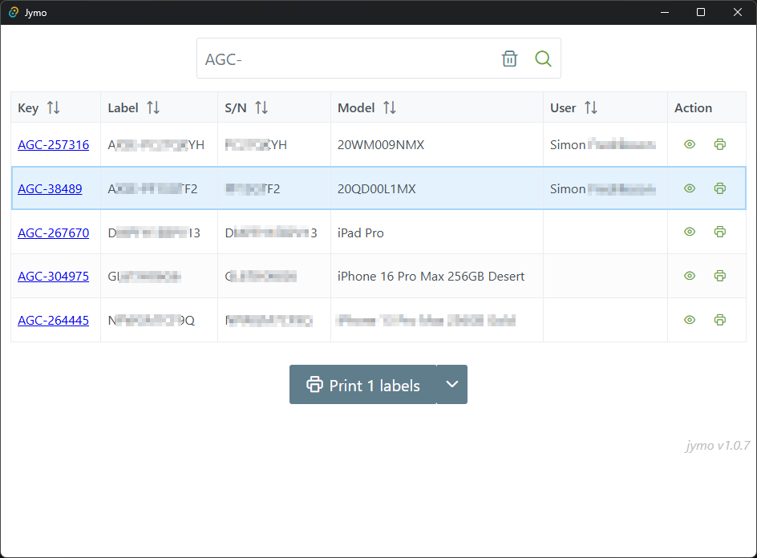

# Jymo!

This is an application that fetch data from Jira's Insight database, and
prints it on a label built in Dymo Connect.

# Requirements

To run, this requires [Dymo Connect Web Service](https://www.dymo.com/support?cfid=dymo-compatibility-chart)
to run on the local machine. Tested with v1.4.x and v1.5.x.

It has been tested on Windows 10 and Windows 11.

# Configuration

The application expects config.json in the installation directory to be
properly filled with an API URL and API Key from Jira. It defaults to
the localhost address for Dymo Connect Web Service. Older versions of
DCWS have issues with certificates and trust. This has since been solved.

## Config while developing

The configuration file(s) are copied when building and testing.
From: `src-tauri/resources/`
To: `src-tauri/debug/resources/`

## .env and .env.local

When building, `.env` points to the name of the configuration file. For testing
it's a good idea to make a new `.env.local` pointing to a local config, for
example `config.local.json`, which is listed in `.gitignore`. This will help
against leaking credentials in git.

## Recommended IDE Setup

- [VS Code](https://code.visualstudio.com/) + [Volar](https://marketplace.visualstudio.com/items?itemName=Vue.volar) + [Tauri](https://marketplace.visualstudio.com/items?itemName=tauri-apps.tauri-vscode) + [rust-analyzer](https://marketplace.visualstudio.com/items?itemName=rust-lang.rust-analyzer)
